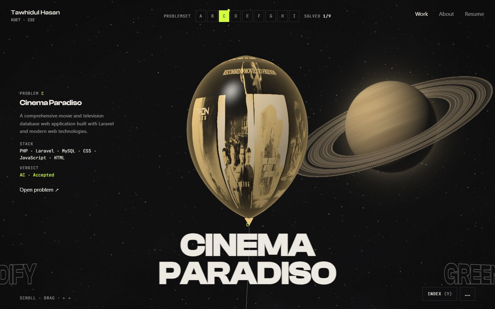
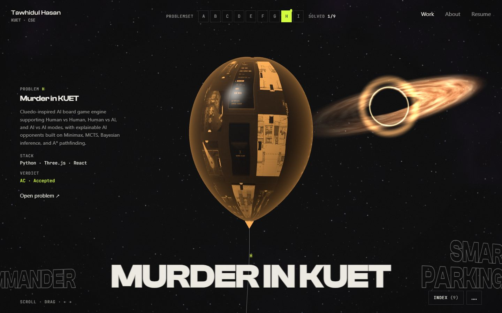
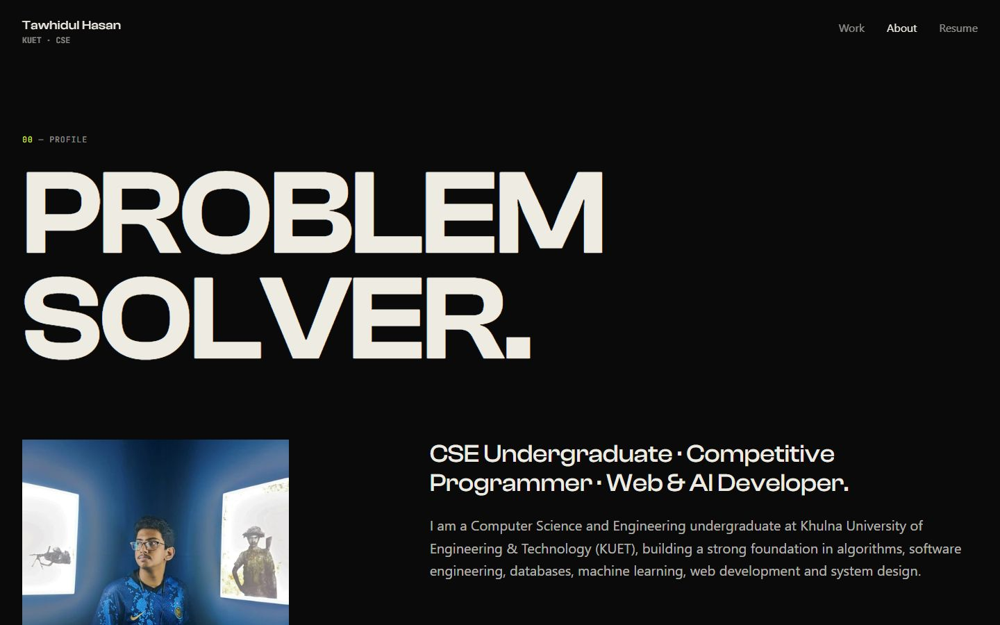
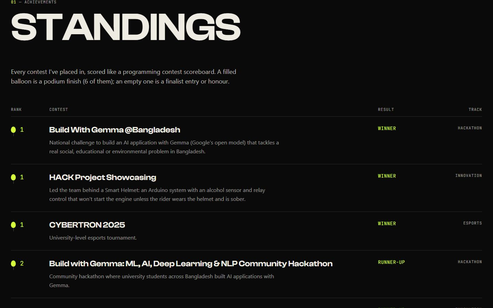
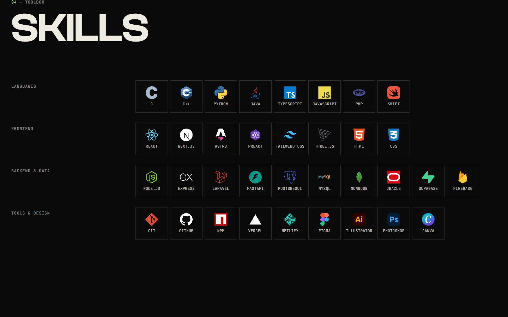
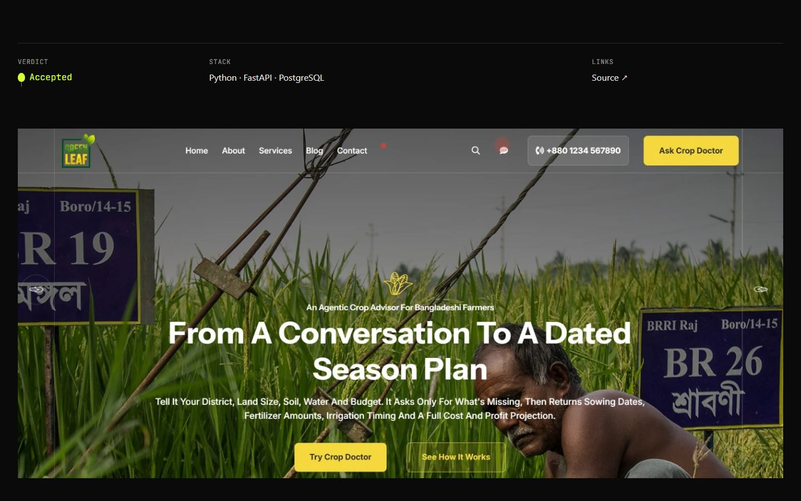
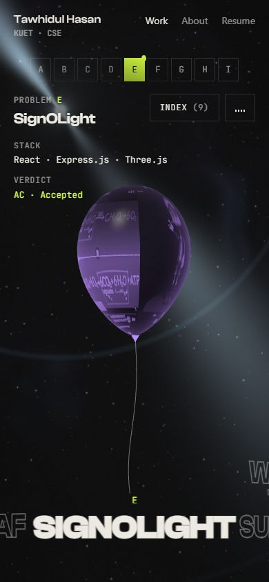

# Tawhidul Hasan — Portfolio

An immersive developer portfolio built with **Astro**, **TypeScript**, **Tailwind CSS v4**, **Three.js** and **GSAP**. The home page presents projects as a contest *problemset*: a WebGL balloon floats in front of a different corner of space for every project, and the whole site is written to feel like a programming-contest scoreboard.

[](https://astro.build)
[](https://www.typescriptlang.org/)
[](https://tailwindcss.com/)
[](https://threejs.org/)
[](https://gsap.com/)
[](../LICENSE)

---

## Table of Contents

- [Preview](#preview)
- [Features](#features)
- [Pages](#pages)
- [Tech Stack](#tech-stack)
- [Project Structure](#project-structure)
- [Getting Started](#getting-started)
- [Available Scripts](#available-scripts)
- [Content & Customization](#content--customization)
- [Accessibility & Performance](#accessibility--performance)
- [Deployment](#deployment)
- [License](#license)
- [Contact](#contact)

---

## Preview

<table>
  <tr>
    <td><strong>Home — Problem C (Saturn)</strong></td>
    <td><strong>Home — Problem H (Black hole)</strong></td>
  </tr>
  <tr>
    <td></td>
    <td></td>
  </tr>
</table>

<details open>
<summary><strong>About</strong></summary>
<br/>

</details>

<details open>
<summary><strong>Standings (achievements)</strong></summary>
<br/>

</details>

<details open>
<summary><strong>Skills</strong></summary>
<br/>

</details>

<details open>
<summary><strong>Project page</strong></summary>
<br/>

</details>

<details>
<summary><strong>Mobile</strong></summary>
<br/>

</details>

---

## Features

- **Projects as a problemset** — each project is "Problem A, B, C…", with a verdict, a stack line and its own page written like a problem statement (Statement / Subtasks / Constraints).
- **One WebGL balloon, nine worlds** — a Three.js balloon carries the current project's screenshot. Each project has its own procedural space scene behind it (Mars, a spiral galaxy, Saturn, an Earth-like planet, a pulsar, Jupiter, Neptune, a black hole and Uranus), all drawn in a fragment shader. The balloon's colour follows the scene, and switching projects grows the next world out from the balloon.
- **Curved title ring** — project names sit on a 3D ring driven by the mouse wheel, drag, swipe or arrow keys, with scrambling text reveals.
- **Scoreboard details** — a problem strip with a balloon for every project you've viewed, a `Solved n/9` counter, an "Accepted" loader and an optional synthesized sound (off by default, no audio files).
- **Achievements as standings** — a contest-style table where podium finishes get a filled balloon and finalist entries an empty one.
- **Smooth scrolling pages** — Lenis + GSAP ScrollTrigger/SplitText on the About and project pages (line-by-line heading reveals, count-up numbers).
- **One dark theme** — ink background, paper text and one lime accent, defined once in CSS tokens; the shaders mirror the same values.
- **Content-as-data** — everything except projects lives in [`src/lib/content.ts`](src/lib/content.ts); projects live in [`src/lib/ProjectsList.ts`](src/lib/ProjectsList.ts) and become new problems automatically.
- **Working contact form** — posts to [Formspree](https://formspree.io/); no backend needed.

## Pages

| Route | What it shows |
| :--- | :--- |
| `/` | The problemset stage: balloon, space world, title ring, scoreboard strip, Index overlay |
| `/about` | Profile, **Standings** (achievements), **Experience**, **Education**, **Skills** and **Contact** |
| `/work/<project>` | One page per project: verdict, stack, screenshot, statement, subtasks, constraints, next problem |

**Keyboard on the home page:** `←` `→` `↑` `↓` / `J` `K` move between problems, `Enter` opens the current one, `Esc` closes the Index. Browser shortcuts such as `Alt+←` are left alone. Deep links work: `/#F` opens on Problem F.

## Tech Stack

| Category | Technology |
| :--- | :--- |
| Framework | [Astro 5](https://astro.build/) (static output) |
| Styling | [Tailwind CSS 4](https://tailwindcss.com/) via `@tailwindcss/vite`, theme tokens in `@theme` |
| Language | TypeScript |
| 3D | [Three.js](https://threejs.org/) (WebGL2 shaders, loaded on demand) |
| Motion | [GSAP](https://gsap.com/) (ScrollTrigger, SplitText, ScrambleText) and [Lenis](https://lenis.darkroom.engineering/) |
| Fonts | Clash Display + General Sans ([Fontshare](https://www.fontshare.com/)), JetBrains Mono (Google Fonts) |
| Images | Astro's `astro:assets` (Sharp): `webp`, responsive `srcset`, lazy loading |
| Forms | [Formspree](https://formspree.io/) |

## Project Structure

```text
myPortfolio/
├── public/
│   ├── favicon.svg
│   └── Tawhidul_Hasan_CV.pdf         # Served statically, linked from the header
├── docs/screenshots/                 # Images used in this README
├── src/
│   ├── assets/
│   │   ├── icons/                    # Tech SVG icons + barrel export (index.ts)
│   │   └── images/                   # Project screenshots/logos + barrel export (index.ts)
│   ├── components/
│   │   ├── SiteHeader.astro          # Name + nav; tucks away while scrolling down
│   │   ├── SiteFooter.astro
│   │   ├── SectionHead.astro         # Numbered section heading
│   │   └── Timeline.astro            # Experience / Education rows
│   ├── layouts/
│   │   └── Layout.astro              # <html> shell, fonts, meta, skip link
│   ├── lib/
│   │   ├── content.ts                # ⭐ Profile, stats, standings, experience, education, skills
│   │   ├── ProjectsList.ts           # ⭐ All project content + tech registry
│   │   ├── problems.ts               # Turns projects into lettered problems + slugs
│   │   └── utils.ts
│   ├── pages/
│   │   ├── index.astro               # The problemset stage
│   │   ├── about.astro
│   │   └── work/[slug].astro         # One static page per project
│   ├── scripts/
│   │   ├── stage.ts                  # Home controller: ring, input, loader, Index overlay
│   │   ├── balloon.ts                # Three.js scene: balloon, string, dust, render passes
│   │   ├── worlds.ts                 # The nine space-world shaders + balloon tints
│   │   ├── scroll.ts                 # Lenis + GSAP reveals for scrolling pages
│   │   └── sound.ts                  # Tiny synthesized sound kit
│   └── styles/
│       └── global.css                # Theme tokens, base styles, view transitions
├── astro.config.mjs
├── components.json                   # shadcn/ui config (path aliases)
├── tsconfig.json
└── package.json
```

## Getting Started

### Prerequisites

- [Node.js](https://nodejs.org/) 18.20.8+ (tested on Node 24)
- npm 9+ (or pnpm/yarn/bun)

### Installation

```bash
git clone https://github.com/mayer-doa-coder/My_Portfolio.git
cd My_Portfolio/myPortfolio
npm install
```

### Development

```bash
npm run dev
```

The dev server starts at [`http://localhost:4321`](http://localhost:4321) with hot module reloading. If you add or remove packages while it is running, restart it — Vite otherwise serves stale pre-bundled dependencies and the console shows `504 (Outdated Optimize Dep)`.

### Production Build

```bash
npm run build
npm run preview   # serve the ./dist build locally to sanity-check it
```

## Available Scripts

All commands run from `myPortfolio/`:

| Command | Action |
| :--- | :--- |
| `npm install` | Install dependencies |
| `npm run dev` | Start the local dev server at `localhost:4321` |
| `npm run build` | Build the static site to `./dist/` |
| `npm run preview` | Preview the production build locally |
| `npm run astro check` | Type-check `.astro` and `.ts` files |

## Content & Customization

- **Add or edit a project** → `src/lib/ProjectsList.ts`. Each entry needs `Logo`, `Shot` and `Mockup` images (exported from `src/assets/images/index.ts`), a `Tech[]` array (from the `TechInfo` registry in the same file) and a `features[]` list. Set `hideProject: true` to hide it, or `Status: "development"` to mark it in progress. It automatically becomes the next lettered problem and gets its own `/work/<slug>` page. Give it a `Source` of `"#"` for projects with no repository. Only nine space worlds exist, so a tenth project reuses the first world.
- **Achievements, experience, education, skills, stats, bio** → `src/lib/content.ts`. Achievements are the `Standings` array (`place: 1–3` gets a filled balloon, `null` an empty one). Experience and Education are `TimelineItem[]`; `period` and `details` are optional. Skills are grouped, each with its icon.
- **Add a tech icon** → drop an SVG into `src/assets/icons/`, export it from `src/assets/icons/index.ts`, then use it in `TechInfo` (`ProjectsList.ts`) and/or `Skills` (`content.ts`). Use icons with a light or coloured fill — dark ones vanish on the dark theme.
- **Change the balloon colour for a world** → `WORLD_TINTS` in `src/scripts/worlds.ts` (same order as the worlds listed at the top of that file).
- **Retheme** → the colour tokens live in `@theme` in `src/styles/global.css`. The shaders repeat the same values as constants (`INK`, `SIG`, `PAPER` in `worlds.ts` and `balloon.ts`), so change them in both places.
- **Change the resume** → replace `public/Tawhidul_Hasan_CV.pdf` (keep the filename, or update the link in `SiteHeader.astro` and `content.ts`).

## Accessibility & Performance

- **Keyboard and screen readers** — every control is reachable by keyboard, the Index overlay traps focus and closes with `Esc`, the current problem is announced politely, and there is a skip link.
- **Reduced motion** — with `prefers-reduced-motion`, scroll reveals, film grain, camera drift and the long first-visit loader are turned off, and world changes are instant.
- **No JavaScript** — the home page falls back to a plain, clickable problem list; every other page renders fully.
- **No WebGL** — if WebGL2 is unavailable the stage shows a flat image of the current project instead of the 3D scene; the reason is logged to the console.
- **Speed** — the 3D code loads after the page appears, shaders compile off the main thread where supported, and the space backdrop renders at reduced resolution and is scaled up (it is soft by design). Images are converted to `webp` and lazy-loaded.

## Deployment

The site builds to static HTML/CSS/JS, so it can be deployed to any static host:

- **[Vercel](https://vercel.com/)** — import the repo, set the root directory to `myPortfolio/`, framework preset `Astro` (auto-detected).
- **[Netlify](https://www.netlify.com/)** — build command `npm run build`, publish directory `myPortfolio/dist`.

## License

Distributed under the [MIT License](../LICENSE).

## Contact

**Tawhidul Hasan**

- Email: [ttawhid401@gmail.com](mailto:ttawhid401@gmail.com)
- GitHub: [@mayer-doa-coder](https://github.com/mayer-doa-coder)
- LinkedIn: [tawhidul-hasan401](https://www.linkedin.com/in/tawhidul-hasan401/)
